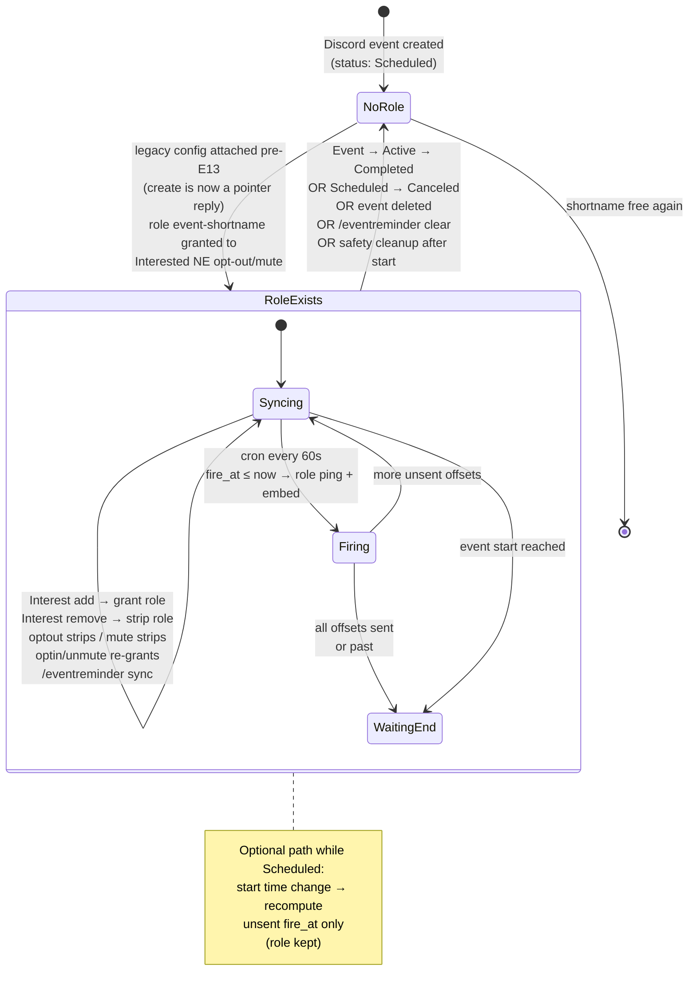
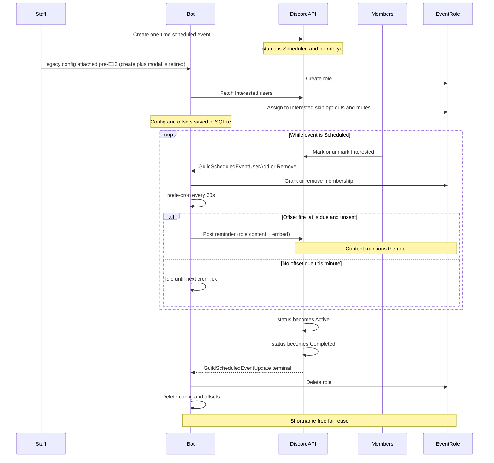
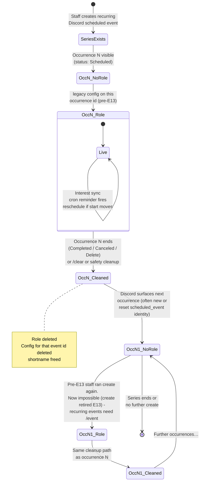
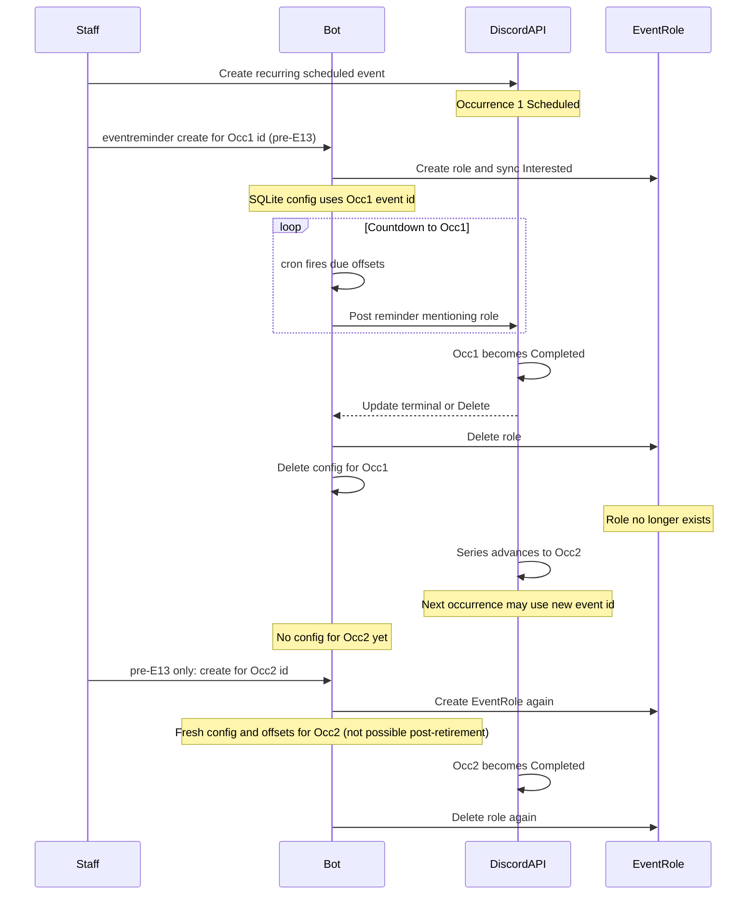

# Scheduled Event Reminders

> **New configs are retired (E13).** `/eventreminder create` now replies with a pointer to
> [`/event`](community-events.md) — the bot-owned Community Events system posts its own events and pings
> **button signups** automatically, with no Interested-role dependency. Existing linked reminder configs
> keep delivering until their Discord scheduled event ends (or you `/eventreminder clear` them);
> `edit`/`clear`/`sync`/`setchannel` stay available for that legacy surface.

Pre-event reminder pings for Discord **Guild Scheduled Events**. Only members who marked **Interested** are notified (via a dedicated `event-<shortname>` role). Users can opt out of **all** reminder pings per guild, or **mute** a single linked event.

## How it works

1. **A config that already exists rides this flow.** `/eventreminder create` is **retired (E13)**: it replies with a pointer to `/event create` / `/event adopt` and returns before the modal ever opens, so no *new* config can exist. Pre-retirement configs keep delivering until cleared or their scheduled event ends.
2. The config carries a shortname (role `event-<shortname>`), reminder offsets, an optional channel override, and an embed description — `/eventreminder edit` re-opens the modal for an existing config.
3. The bot creates role `event-<shortname>`, grants it to currently Interested users (minus guild opt-outs and per-event mutes), and keeps the role in sync as interest changes.
4. At each offset before start, the bot posts **one message**: role mention in content + an **embed** with event details in the notify channel.
5. When the event completes/cancels (or on `/eventreminder clear`), the bot deletes the role and config (and any mute rows for that event) so shortnames can be reused.

## Role lifecycle (with the Discord event)

Configs are keyed by Discord’s `scheduled_event_id`. The bot-managed role `event-<shortname>` lives only while that config is active. Terminal Discord statuses (**Completed**, **Canceled**), event **delete**, manual **clear**, or ticker safety cleanup all run the same path: **delete the Discord role + delete the DB config** (shortname freed for reuse).

### One-time event

**Timeline view (one-time):**

### Recurring event (series)

Discord can attach a **recurrence rule** to a scheduled event. The bot still binds reminders to **one** `scheduled_event_id` (one occurrence object at a time). It does **not** automatically re-attach when Discord advances the series to a new occurrence/event id.

**Timeline view (recurring, two occurrences):**

| | One-time | Recurring (current MVP) |
|--|----------|-------------------------|
| Role created | When the legacy config was attached (pre-E13; `create` is retired) | Same, **per occurrence configured** (pre-E13) |
| Role while live | Synced to Interested ∩ ¬opt-out ∩ ¬mute | Same |
| Reminder messages | Offsets before that start (embed + role ping) | Offsets before **that** occurrence's start |
| Role deleted | Complete / cancel / delete / clear / safety | Same when **that** occurrence is terminal |
| Next occurrence | N/A | **No automatic re-link** — and no way to attach a new legacy config (create retired E13): run the series through [`/event`](community-events.md) instead |

## Permissions

| Action | Who |
|--------|-----|
| Edit / clear / sync for an event | **Manage Server** **or** that scheduled event’s **creator** |
| `/eventreminder create` | Retired pointer reply — no gate, nothing to configure |
| Set default notify channel | **Staff gate** (Manage Server or any staff role) |
| Opt out / opt in / mute / unmute / status | Everyone |

Bot needs: **Manage Roles** (role above `event-*`), **Send Messages** (and ability to mention the role by ID) in the notify channel. Enable the **Guild Scheduled Events** intent in the Developer Portal.

## Commands

| Command | Description |
|---------|-------------|
| `/eventreminder create event: [persistent]` | **RETIRED (E13)** — no modal opens, `persistent` never acts. Replies ephemerally with the pointer: “📆 **New reminder configs are retired** — create the event with `/event create` (or `/event wizard`) instead…”, “`/event adopt scheduled_event:<id>` turns it into a draft bot event”, and notes that existing configs keep firing via `edit`/`list`/`clear`/`sync`/`setchannel` |
| `/eventreminder edit event:` | Re-open modal for an existing config |
| `/eventreminder list` | Active configs, offsets, next fire |
| `/eventreminder clear event:` | Stop reminders, delete role + DB rows |
| `/eventreminder sync event:` | Re-fetch Interested users and reconcile roles |
| `/eventreminder setchannel [channel]` | Guild default notify channel |
| `/eventreminder optout` | Opt out of all reminder roles/pings in this guild |
| `/eventreminder optin` | Re-enable; re-grant roles for events you are still Interested in (skips muted) |
| `/eventreminder mute event:` | Mute one linked event (strip that role; block future grants) |
| `/eventreminder unmute event:` | Clear mute; re-grant if still Interested and not guild-opted-out |
| `/eventreminder status` | Guild opt-out, muted events, and event roles you hold |

## Modal fields

Reachable only via `/eventreminder edit` on an existing config — the create modal retired with the command (E13).

| Field | Purpose |
|-------|---------|
| Shortname | Role suffix → `event-<shortname>` (`[a-z0-9-]`). **Edit** prefills the config's current shortname; it must stay unique (the create-time slug suggestion `title-2`/`title-3` died with the retired command) |
| Offsets (multi-select) | Presets: 1 week, 1 day, 1 hour, 30 min, 15 min, 5 min (defaults: 1d, 1h, 15m) |
| Extra custom offsets | Freeform `2h, 10m` (`(\d+)(m\|h\|d)`) |
| Channel override | Optional; empty uses guild default |
| Custom embed description | Optional body for the reminder **embed**. Leave empty for the default (`Starts {starts_in}`) |

**Recurring ("persistent")** is **not** a modal field (Discord caps modals at 5 fields). Toggle it with the **♾️ Recurring: on/off** button on the **edit** confirmation — that button row also reflects the config's current state. (The `persistent` slash option only ever acted on the create modal, which is retired; setting it there does nothing.) When **on**, the `event-*` role and config survive an occurrence completing and are only removed by `/eventreminder clear`. Edit submissions leave the current recurring state untouched.

### Placeholders (embed description)

| Token | Meaning |
|-------|---------|
| `{event}` | Event name |
| `{location}` | Voice/stage channel mention or external location text |
| `{starts_in}` | Relative Discord timestamp (`<t:unix:R>`) |
| `{starts_at}` | Full Discord timestamp (`<t:unix:F>`) |
| `{url}` | `https://discord.com/events/{guildId}/{eventId}` |
| `{description}` | Event description (trimmed, max ~300 chars) |
| `{offset}` | Human offset for this fire (e.g. `1 hour`) |
| `{role}` | Role mention text (does **not** ping inside the embed) |

**`{location}`:** if the scheduled event is hosted in a voice/stage channel, expands to a channel mention (`<#id>`). For external events, expands to the external location text. Empty when unset. Trailing ` in ` clauses are dropped when location is empty.

### Delivery shape

Every due offset posts:

1. **Content:** `<@&role>` (this is what notifies role holders)
2. **Embed:** title = event name, optional event URL, description (custom or default), fields for Starts / Location / Reminder offset, cover image when available

Role mentions inside embed bodies do **not** notify in Discord — the content line is required.

Offsets already in the past relative to the event start are skipped. Max **8** offsets; max lookback **30 days**.

## Opt-out and mute

| Mode | Command | Scope |
|------|---------|--------|
| Guild opt-out | `/eventreminder optout` / `optin` | All events in this guild |
| Per-event mute | `/eventreminder mute` / `unmute` | One linked config |

- **Guild opt-out always wins:** muting/unmuting does not restore roles while guild-opted-out; use `optin` first.
- Mute strips that event’s reminder role and blocks future grants for that `scheduled_event_id`.
- Unmute re-grants only if you are still **Interested** and not guild-opted-out.
- Mute rows are deleted when the event config is cleared (complete / cancel / delete / `/clear`).

## Delivery & cleanup

- Background **node-cron** job every **60 seconds** (`* * * * *`) posts due offsets and runs safety cleanup (same dependency as XP decay).
- Gateway: interest add/remove, event update (reschedule or terminal), event delete.
- Reschedule: unsent `fire_at` values recomputed when the event start time changes.

### Offset delivery states

Each offset row carries an explicit delivery state instead of relying on
`sent_at IS NULL` alone (which conflated "not sent", "can't send", and "sent"):

| State | Meaning |
|-------|---------|
| `pending` | Not yet delivered (or waiting for its next retry). Claimable when `COALESCE(next_attempt_at, fire_at) ≤ now`. |
| `sending` | Currently claimed by a ticker (atomic compare-and-set, so two tickers can never deliver the same offset). A crashed sender is recovered: claims older than the **5-minute lease TTL** become claimable again. |
| `sent` | Terminal — the message reached Discord (`sent_at` + `message_id` recorded). |
| `retired` | Terminal — the reminder **can't** be delivered: the notify channel is gone (Discord `10003`/`10004`) or exists but is unsendable, or the event instance ended under a persistent (recurring) config. Retired **on first detection** — never re-claimed, so a deleted channel no longer burns the claim queue every minute. The config itself stays active so an operator can point it at a new channel via `/eventreminder edit` (re-arms a fresh offset row). |
| `failed` | Terminal — a transient failure exhausted the retry budget (**12 attempts**). |

**Transient vs gone:** network errors, 5xx, rate limits, missing access, a
not-yet-cached guild, or a not-yet-configured channel are **transient**: the
row goes back to `pending` with `attempts+1` and a growing backoff —
1 min, 2, 4, 8, … doubling, capped at 6 h — and a retry is **never scheduled
earlier than the original offset + one ticker tick**. After 12 failed attempts
(~1 day of outage coverage) the offset goes `failed`. Only explicit
"target is gone" classifications retire. Every transition logs the specific
cause with the offset/config ids; the last reason is also stored on the row
(`last_error`).

Migration `038` added `status`, `attempts`, `next_attempt_at`, `claimed_at`,
and `last_error` to `event_reminder_offsets` (rows already sent are backfilled
to `sent`).

## Database

Tables: `event_reminder_configs`, `event_reminder_offsets`, `event_reminder_optouts`, `event_reminder_event_optouts` (per-event mutes).  
Guild setting: `event_reminder_channel_id`.

See [database.md](database.md) and [architecture.md](architecture.md).
